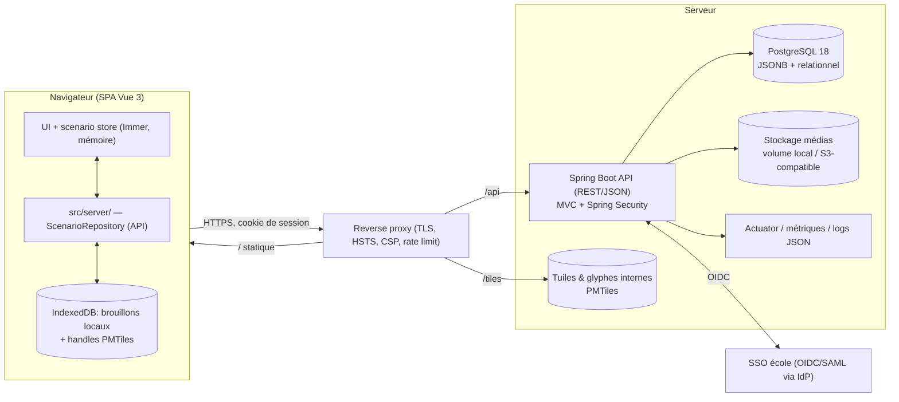

# 01 — Architecture cible (API-first, Spring Boot)

> Statut : **proposition, en attente de validation**. Aucun code applicatif n'est écrit.
> **[F]** fait constaté · **[H]** hypothèse · **[R]** recommandation. Les constats sur le code renvoient à `00-analysis.md`.
> Les décisions structurantes ont un ADR dans `docs/adr/` (0012 à 0023), au format du dossier (titre + paragraphe de décision), complété d'une section « Options » pour respecter votre exigence de comparaison.

## 0. Versions vérifiées (sources officielles, au 2026-11-03)

| Brique | Constat | Source | Statut |
|---|---|---|---|
| Spring Boot | **4.1.2** affiché sur la page du projet | [spring.io/projects/spring-boot](https://spring.io/projects/spring-boot) | version lue ; la page ne dit pas explicitement « GA » mais 4.1.2 est un correctif de la branche 4.1 |
| Prérequis Boot 4.1.2 | Java **17 minimum**, compatible jusqu'à **Java 27** ; Spring Framework **7.0.10+** ; Maven 3.6.3+ ; Gradle 8.14+ ou 9.x ; Tomcat 11 / Jetty 12.1 (Servlet 6.1) | [docs.spring.io/spring-boot/4.1.2/system-requirements.html](https://docs.spring.io/spring-boot/4.1.2/system-requirements.html) (via moteur de recherche) | lu dans les résultats de recherche, page non ouverte directement |
| Java LTS | **Java 25 = LTS courante** ; LTS précédentes 8/11/17/21 ; prochaine LTS **Java 29 (septembre 2027)** ; support Premier de Java 25 jusqu'à sept. 2030 ; Java 17 jusqu'à sept. 2026 (donc déjà en fin de Premier Support) ; Java 21 jusqu'à sept. 2028 | [Oracle Java SE Support Roadmap](https://www.oracle.com/java/technologies/java-se-support-roadmap.html) (copies régionales via recherche ; page principale renvoyait 403) | dates « subject to change » selon Oracle |
| PostgreSQL | **18** est la dernière majeure supportée (EOL nov. 2030) ; politique : 5 ans par majeure, une release mineure simultanée pour toutes | résultats de recherche secondaires ([Instaclustr](https://www.instaclustr.com/education/postgresql/postgres-versions-supported-releases-eol-dates-upgrades/), [Neon](https://neon.com/docs/postgresql/postgres-version-support)) | **non vérifié sur postgresql.org** (hôte injoignable depuis la session) ; mineures contradictoires (18.4 vs 18.6) ; existence d'une 19 non contrôlée |

**[R]** Cibler **Java 25 (LTS) + Spring Boot 4.1.x + PostgreSQL 18**, et **épingler les versions exactes (patch) au démarrage de la phase 0** après vérification sur postgresql.org / Maven Central depuis un poste connecté. Les versions des autres bibliothèques (Flyway, springdoc, Testcontainers, validateur JSON Schema…) ne sont volontairement **pas citées** : elles doivent être lues sur Maven Central au moment d'écrire le `pom.xml`.

## 1. Exigences retenues et hypothèses de travail

Décidé par vous : backend Spring Boot/REST, **API-first**, serveur = source de vérité (comptes, droits, scénarios), front Vue = client, auth/rôles/partage/pédagogie/historique/traçabilité, déploiement sérieux.

Hypothèses par défaut (à confirmer, cf. §Q) : [H] ≤ 500 utilisateurs, ≤ 50 éditeurs simultanés ; hébergement maîtrisé par l'école (on-prem/cloud privé), pas de classification « secret défense » ; une seule langue au départ (le front n'a aucune bibliothèque i18n : **[F]** absente de `package.json`) ; accessibilité de bon niveau mais pas de certification ; hors-ligne terrain **non** requis en phase 1.

## 2. Schéma d'architecture



**[R]** Une seule origine (`https://orbat.ecole.example`) : le proxy sert la SPA statique, `/api` vers Spring, `/tiles` vers les tuiles. Cela supprime CORS, simplifie les cookies `SameSite` et la CSP.

## 3. Décisions d'architecture

### D0 — Plateforme : Spring MVC (pas WebFlux), Java 25, Maven, modulithe par fonctionnalités
**Options (MVC vs WebFlux)** — MVC : pile bloquante simple, adaptée à JDBC/JPA, threads virtuels disponibles (Java 21+) pour la concurrence ; WebFlux : utile pour des milliers de connexions longues (streaming/WebSocket massif), mais nécessite R2DBC ou isolement du JDBC bloquant, plus complexe à déboguer. **[R] MVC**. ADR-0012.
**Maven vs Gradle** — Maven : convention stricte, BOM `spring-boot-starter-parent`, courbe douce, très répandu en entreprise/écoles ; Gradle (≥ 8.14/9.x supporté) : build incrémental plus rapide, DSL plus flexible mais plus de variabilité. **[R] Maven** (le front reste en pnpm ; les deux builds sont indépendants, assemblés par Docker multi-étapes). ADR-0020.
**Structure des packages** — (a) hexagonale stricte (ports/adapters partout) : excellente isolation, mais cérémonie lourde pour un CRUD documentaire ; (b) couches classiques par type (`controller/service/repository`) : simple mais couple les fonctionnalités ; (c) **modulithe par fonctionnalité**, couches internes légères (`web`, `application`, `domain`, `persistence`), ports uniquement aux frontières externes (stockage médias, IdP, horloge) et règles vérifiées par des tests d'architecture. **[R] (c)** : `identity`, `organization`, `scenario`, `pedagogy`, `audit`, `media`, `shared`. ADR-0020.

### D1 — Modèle de persistance du scénario : **hybride (c)**
- **(a) Document JSONB opaque + métadonnées relationnelles** : le plus proche du front (le `Scenario` externe est déjà un document autoportant, **[F]** `scenarioModels.ts:406`), migrations de schéma gérées par le client, effort faible ; mais requêtes/filtrage fin impossibles sans extraction, validation limitée.
- **(b) Relationnel complet** (sides, units, states, events, layers…) : requêtes riches, contrôle d'accès fin par unité ; mais ~30 tables, **recopie du modèle TS qui évolue vite** (version 3.7.0, plusieurs bumps ; upgrade.ts 601 l.), reconstruction du document à chaque lecture, effort XL et dérive quasi certaine face à l'amont.
- **(c) Hybride** : **document JSONB versionné** (source de vérité du contenu) + **métadonnées relationnelles** + **index extraits** à chaque révision (`scenario_summary` : nom, description, début, standard de symbologie, nb d'unités, noms des sides ; plus tard `scenario_unit_index` pour la recherche inter-scénarios).
- **[R] (c)**. Impacts évalués :

| Critère | (a) | (b) | **(c)** |
|---|---|---|---|
| Validation serveur | schéma JSON seulement | contraintes SQL + Bean Validation | schéma JSON + règles sémantiques ciblées |
| Filtrage par rôle (masquer l'adversaire) | à faire sur JsonNode | requêtes SQL | **à faire sur JsonNode au moment de dériver une copie** (D5) |
| Recherche | impossible | native | via index extraits |
| Migrations de schéma | côté client, aucune sur le serveur | migrations Flyway pour chaque évolution amont | **client migre ; serveur stocke `schema_version`** |
| Performance | lecture/écriture d'un blob (TOAST) | multiples jointures | blob + listes via colonnes |
| Effort | S | XL | M |

ADR-0013.

### D2 — Contrat de données front/back : **deux contrats distincts**
1. **Enveloppe d'API** (utilisateurs, organisations, métadonnées, révisions, erreurs) : **OpenAPI comme source de vérité**, produit par Spring (`springdoc-openapi`) puis **commité** (`backend/openapi/openapi.json`) ; le CI régénère et **échoue en cas de diff non commité** ; le front génère ses **types TypeScript** depuis ce fichier (générateur de types, ex. `openapi-typescript` — version à lire sur npm le moment venu).
2. **Document `Scenario`** (opaque côté Java) : **JSON Schema généré depuis les types TypeScript** (`src/types/scenarioModels.ts`) par un outil de génération, **commité** et versionné avec `SCENARIO_FILE_VERSION`. Java le charge pour valider (`additionalProperties` **autorisées** : l'amont ajoute des champs ; on est strict uniquement sur ce qui touche la sécurité : URL, `data:`, tailles, profondeur).
- **Options écartées** : DTO Java manuels du document (dérive garantie, voir D1-b) ; schéma écrit à la main (désynchronisé) ; TS généré depuis Java (le TS est ici l'autorité du document).
- **Anti-dérive** : un test CI valide les **trois scénarios de démo** et les fixtures de tests (`src/testdata`) contre le schéma ; un job « amont » régénère le schéma après chaque merge et signale le diff. ADR-0014.

### D3 — Sauvegarde côté front, concurrence, IndexedDB, singlefile
**Options** : (1) **snapshot** (document complet) ; (2) **patches RFC 6902** ; (3) **opérations** métier (journal d'actions).
- **[F]** Patches inutilisables en l'état (IDs de ressources régénérés, état interne mélangé à des champs dérivés : `00-analysis.md` §3.2 et §4).
- **[R] Phase 1 : snapshot** sur action explicite *et* autosave espacé (reprise de la mécanique brouillon+révision existante, `io.ts:496-594`), `PUT /scenarios/{id}/content` avec **`If-Match: "<revision>"`** ; réponse `ETag` ; **412** en cas de conflit → écran « recharger / enregistrer sous copie ». Taille limitée (config, 16 Mo par défaut), compression `gzip` acceptée.
- **Perte réseau** : le brouillon reste dans IndexedDB (déjà existant), l'indicateur d'état passe par : `saved → dirty → saving → saved | offline(draft local) | conflict | error`. Au retour réseau, relecture de la révision serveur : si inchangée → push ; sinon conflit.
- **[R] IndexedDB** : **réduit au rôle de cache de brouillon + handles PMTiles** (stores `scenario-drafts` et `basemap-archive-handles`) ; les stores `scenario-blobs`/`scenario-metadata` ne sont plus la source de vérité (utilisés uniquement par un outil d'**import unique** « envoyer mes scénarios locaux sur le serveur »).
- **Build `singlefile`/hors-ligne** : **[R] conservé tel quel mais hors périmètre produit** (non supporté, non livré avec le produit serveur, exclu de la CI du produit). Il reste utile pour la sauvegarde de continuité sans réseau, avec import/export de fichiers. Si l'école veut un hors-ligne terrain synchronisé, c'est un chantier séparé (cf. §Q).
- Évolutions possibles après mesure : patches ou opérations (phase 6) en s'appuyant sur `ActionLabel`/`meta` de l'immerStore. ADR-0015.

### D4 — Authentification et autorisation
- **Sessions vs JWT** — *Session cookie* (Spring Security, `HttpOnly`, `Secure`, `SameSite=Lax/Strict`, CSRF par jeton) : le jeton n'est jamais lisible par JavaScript (un XSS ne l'exfiltre pas), révocation immédiate, adaptée à une SPA de même origine ; *JWT en navigateur* (PKCE, stockage mémoire/`localStorage`) : stateless, mais exposé au XSS, révocation difficile. **[R] session cookie** pour la SPA ; **JWT/Resource Server** réservé à de futurs clients non navigateur.
- **Comptes locaux + SSO** — **[R]** Phase 1 : comptes locaux dans Spring (table `app_user`, hash **Argon2id** ou bcrypt via `PasswordEncoder`, verrouillage progressif, politique de mot de passe). Phase 5 : **OIDC** (`oauth2Login`) vers l'IdP de l'école, avec correspondance `sub` → `app_user` et mapping groupes IdP → rôles. Éviter d'introduire Keycloak tant que l'IdP de l'école n'est pas connu : un composant de moins à exploiter. Si l'école n'a pas d'IdP et veut du SSO/MFA, Keycloak devient la bonne option (comparaison dans l'ADR). SAML : à évaluer seulement si l'IdP l'impose (§Q).
- **RBAC à portée** : rôle global (`ADMIN`, `USER`) ; **appartenance (`membership`) par organisation / promotion (`cohort`) / équipe (`team`)** avec rôle `INSTRUCTOR | STUDENT | OBSERVER` ; **ACL par scénario** (`OWNER | EDITOR | VIEWER`) ; règles de dérivation : l'instructeur d'une promotion voit les copies de travail de ses élèves, un élève ne voit que les siennes, un observateur voit en lecture seule ce qui lui est attribué.
- **Application côté serveur** : toute ressource passe par un `AuthorizationService` (méthodes `@PreAuthorize` + `PermissionEvaluator`), **jamais** par l'UI. Tests de sécurité systématiques (matrice rôle × endpoint). ADR-0016.

### D5 — Domaine pédagogique
Modèle : **`Exercise`** (énoncé + référence au scénario « modèle », révision figée) → **`Assignment`** (publication à une `cohort`/`team`, dates d'ouverture/limite, politique de visibilité) → **`WorkCopy`** (scénario *dérivé* par élève ou équipe, `status` : `DRAFT | SUBMITTED | LOCKED | RETURNED`) → **`Feedback`** (commentaires/annotations de l'instructeur, ancrés sur `unitId`, `featureId`, `eventId`, temps).
- **Filtrage d'information par rôle** : les options sont (i) **dériver une copie filtrée à la publication** (le document de l'élève ne contient jamais le dispositif adverse) ; (ii) filtrer à chaque lecture selon le rôle. **[R] (i)** : plus sûr (le secret n'existe pas côté élève), plus simple à raisonner, et aligné sur le concept existant de *recipient export* + *snapshot group* (**[F]** `recipientScenario.ts`, GLOSSARY). Une copie élève peut contenir un *snapshot group* des unités adverses détectées à un instant donné.
- Implémentation : un `ScenarioProjector` Java opère sur le `JsonNode` (retrait de `sides`/`groups`, **élagage des références pendantes** — `events[].where.units/features`, items de couches liés — puis validation) ; **tests dorés partagés** avec les fixtures de `recipientScenario.test.ts` pour éviter la divergence TS/Java.
- Verrouillage : `LOCKED` après `deadline` ou soumission ; le serveur refuse les `PUT` (409/423) ; l'instructeur peut rouvrir. ADR-0017.

### D6 — Versionnage, historique, audit
- **Snapshots immuables** dans `scenario_revision` (une ligne par sauvegarde explicite, soumission, restauration, import) + **autosaves coalescés** (le serveur ne conserve que la dernière autosave par fenêtre, config) ; **restauration** = nouvelle révision copiée d'une ancienne (jamais de réécriture).
- **Journal de patches** : repoussé (voir D3). **[H]** coût de stockage : 5 Mo × 50 révisions × 500 scénarios ≈ 125 Go brut, ≈ 25 Go après compression TOAST (ordre de grandeur, à mesurer) → **politique de rétention** obligatoire (garder toutes les manuelles/soumissions, élaguer les autosaves).
- **Audit** : table `audit_event` **append-only** (qui, quand, quoi, ressource, IP, résultat), alimentée côté serveur ; option de chaînage de hachages ; couvre connexion, lecture de scénarios sensibles, export, partage, changements de droits, soumission, correction. ADR-0018.

### D7 — Médias et fichiers
**[F]** Les médias sont aujourd'hui des **URL** (`Media.url`), avec possibilité d'images base64 (`CustomSymbol.src`). **Options** : disque local (volume Docker) / stockage S3-compatible (MinIO, Garage, S3 d'un cloud privé). **[R]** Interface `MediaStorage` avec implémentation **volume local** d'abord (simple, une seule instance), implémentation S3-compatible au besoin (multi-instances / Kubernetes). Licence et maintenance de MinIO : **à vérifier** avant de le retenir. Contrôles : limite de taille, type par signature (pas par extension), ré-encodage des images, analyse antivirus optionnelle (ClamAV en conteneur), URL servies derrière contrôle d'accès, `Content-Disposition`/`nosniff`. Phase 4. ADR-0021.

### D8 — Sécurité et conformité
- **Réseau** : TLS partout, HSTS, CSP stricte (`default-src 'self'`; `connect-src 'self' <tuiles internes>`; pas d'`unsafe-inline/eval`), `Referrer-Policy`, `X-Content-Type-Options`, `frame-ancestors 'none'`. CORS inutile (même origine).
- **Applicatif** : CSRF, rate limiting (proxy + limitation applicative sur login/exports), verrouillage de comptes, validation des entrées (taille, profondeur JSON, URL, `data:`), `rel="noopener noreferrer"` sur les liens (**[F]** absent aujourd'hui, `formatting.ts:24`).
- **Marquage de sensibilité** : `scenario.sensitivity` (valeurs configurables par l'organisation, ex. `OPEN | INTERNAL | RESTRICTED`) qui **contraint** partage, export, copie hors organisation, et journalise les lectures. **Ce n'est pas une garantie de conformité à une réglementation de classification** : toute exigence « Diffusion Restreinte »/« secret » impose une homologation que ce document ne prétend pas couvrir (§Q).
- **Données** : chiffrement du volume/disque (et des sauvegardes), secrets via variables d'environnement/Docker secrets (Vault ensuite), sauvegardes `pg_dump`/archivage continu testés par restauration, RGPD (registre, minimisation, durées de conservation, pseudonymisation des auteurs à la suppression d'un compte, export des données).
- **Services externes** : fonds de carte, glyphes, géocodage et altitudes **remplacés par des ressources internes** (`/tiles`) ; `maplibreConfig.json` servi par l'API selon la politique de l'organisation ; géocodage désactivé ou interne ; liens contextuels (Bing/Google/OSM) masquables ; `fetch(url)` utilisateur restreint par CSP et allow-list ; **suppression de la fonction Cloudflare `share.ts`**. ADR-0019.

### D9 — Temps réel / collaboration : **pas au départ**
Options : (a) **aucun** (dernière écriture refusée par ETag) ; (b) **verrou d'édition simple** (un seul éditeur par scénario/copie, verrou à bail avec heartbeat) ; (c) **WebSocket + patches** (diffusion d'opérations) ; (d) **CRDT** (Yjs/Automerge).
- **[F]** (c) et (d) se heurtent aux IDs instables et à l'état interne mêlé (§4 de l'analyse) ; (d) exigerait de remodeler le store → effort XL.
- **[R]** Phase 1-3 : (a)+(b) ; phase 6 (optionnelle) : **vue instructeur en direct, lecture seule** (SSE/WebSocket qui pousse les nouvelles révisions) — suffisant pour le suivi d'exercices ; la co-édition simultanée n'est reprise que sur besoin avéré. ADR-0022.

### D10 — Organisation du dépôt, CI
```
/ (racine existante)
├── src/, public/, ...            # front amont (inchangé autant que possible)
├── src/server/                   # NOUVEAU : client API, auth, dépôt, pages login/admin/pédagogie
├── vite.server.config.ts         # NOUVEAU : substitution de modules (cf. 00-analysis §10)
├── backend/                      # NOUVEAU : Maven, Spring Boot
│   ├── pom.xml
│   ├── src/main/java/.../{identity,organization,scenario,pedagogy,audit,media,shared}
│   ├── src/main/resources/db/migration/   # Flyway
│   └── openapi/openapi.json      # contrat commité
├── schemas/scenario.schema.json  # NOUVEAU : JSON Schema généré depuis les types TS
├── deploy/                       # NOUVEAU : compose.yaml, Caddyfile/nginx.conf, .env.example
└── docs/backend/, docs/adr/
```
- **[R]** Workflow CI séparé du CI amont : `backend-ci` (build Maven, tests avec Testcontainers/PostgreSQL, contrôle diff OpenAPI), `frontend-ci` (type-check + tests + régénération des types + contrôle diff du schéma), `docker-build`. **[F]** Le seul workflow actuel cible la branche `deploy` ; il ne lance pas ESLint.

### D11 — Déploiement
- **Départ : Docker Compose** : `proxy` (Caddy ou Nginx, TLS), `api`, `db` (PostgreSQL 18, volume chiffré), `tiles` (statique PMTiles avec `Range`), `backup` (planifié), plus `keycloak` seulement si requis. Un `.env` par environnement (`dev`, `recette`, `prod`) ; profils Spring `dev|recette|prod`.
- **Observabilité** : Actuator sur port de gestion non exposé (health, métriques Prometheus), logs JSON (le *structured logging* natif existe depuis Spring Boot 3.4 d'après ma connaissance — **[H] à confirmer dans la doc 4.1**), identifiant de corrélation par requête.
- **Kubernetes ensuite** : API sans état (sessions en base via Spring Session JDBC), PostgreSQL géré ou opérateur, Ingress, secrets natifs ; migration sans réécriture. **[R]** Ne pas commencer par K8s. ADR-0023.

### D12 — Réutilisation de la logique TypeScript côté serveur
Options : (a) porter en Java ; (b) laisser au client ; (c) exécuter le TS côté serveur (sidecar Node/GraalJS).
- **Serveur Java** : validation (schéma + règles sémantiques), extraction de résumé/index, **projection/filtrage par rôle** (D5), création de copies.
- **Client** : projection temporelle de la hiérarchie (`syncTimedHierarchyProjection`, `time.ts`), migrations de version (`upgrade.ts`), exports (KML, XLSX, MilX, GeoJSON…), rendu et symbologie.
- **Écarté** : (c) — dépendance d'exécution supplémentaire, surface d'attaque, divergence de comportement. Si un export serveur devient nécessaire (rapports PDF), le traiter comme un module séparé. ADR-0014 (contrat) couvre ce partage de responsabilités.

## 4. Plan de réalisation

Légende effort : S ≈ 1-2 semaines · M ≈ 3-6 · L ≈ 6-12 (une personne, ordre de grandeur relatif, **[H]**).

| Phase | Valeur livrée | Dépend de | Effort | Principaux risques | Critères d'acceptation vérifiables |
|---|---|---|---|---|---|
| **P0 Fondations** | Squelette backend + CI + Compose + contrat OpenAPI→types TS ; schéma JSON généré | — | S/M | Versions non épinglées ; génération de schéma sur unions complexes | `docker compose up` → `/actuator/health` = UP ; CI verte ; modification d'un DTO sans régénération = CI rouge ; les 3 démos valident contre `scenario.schema.json` |
| **P1 Comptes + scénarios personnels** | Connexion locale, CRUD scénarios, sauvegarde avec révisions, import de mes scénarios locaux | P0 | L | Adaptateur front (11 appelants), UX conflits, tailles | Création/sauvegarde/réouverture depuis un autre navigateur ; **412** sur écriture concurrente testé ; coupure réseau → brouillon local → reprise ; 100 % des endpoints ont un test d'autorisation ; import IndexedDB→serveur sans perte (comparaison de clés `getScenarioComparisonKey`) |
| **P2 Organisations, RBAC, partage, audit** | Organisation/promotions/équipes, ACL par scénario, partage interne, journal d'audit, admin | P1 | L | Complexité des droits ; XSS inter-utilisateurs | Matrice rôle×endpoint vérifiée automatiquement ; corpus XSS rejeté/neutralisé sur Markdown et propriétés ; CSP active sans violation sur parcours nominal ; chaque lecture/écriture/partage génère un `audit_event` |
| **P3 Pédagogie** | Exercices, affectations, copies de travail filtrées, dates limites, verrouillage, soumission, annotations | P2 | L | Filtrage d'information (fuite de l'adversaire) ; divergence TS/Java | **Aucun octet** du side masqué dans le document d'un élève (test automatisé sur l'API et la base) ; verrouillage refusé en écriture après `deadline` ; l'instructeur lit toutes les copies de sa promotion et aucune autre |
| **P4 Historique et médias** | Navigateur de révisions, restauration, rétention ; upload d'images contrôlé | P1 (P2 pour droits) | M | Volume des révisions ; fichiers malveillants | Restauration d'une révision = nouvelle révision identique (hash) ; rétention exécutée ; upload refusé hors types/tailles autorisés ; accès média soumis aux droits du scénario |
| **P5 SSO et durcissement** | OIDC, mapping de rôles, limitation de débit, sauvegardes/restauration testées, RGPD, test d'intrusion | P2 | M | Spécificités de l'IdP de l'école | Connexion SSO de bout en bout ; restauration de sauvegarde chronométrée et rejouée ; rapport de test d'intrusion sans critique ouverte |
| **P6 (optionnelle) Temps réel / hors-ligne avancé** | Vue instructeur en direct ; éventuellement sync incrémentale | P3 | L | IDs instables ; complexité | Décision prise **sur mesures** (latence, tailles, usage) ; sinon non réalisée |

Ordre alternatif : si le SSO est contractuellement requis dès le démarrage, avancer P5 (OIDC seul) avant P2.

## 5. Modèle de données initial (ER)

```mermaid
erDiagram
  APP_USER ||--o{ MEMBERSHIP : has
  ORGANIZATION ||--o{ COHORT : contains
  COHORT ||--o{ TEAM : contains
  ORGANIZATION ||--o{ MEMBERSHIP : scopes
  COHORT ||--o{ MEMBERSHIP : scopes
  TEAM ||--o{ MEMBERSHIP : scopes
  ORGANIZATION ||--o{ SCENARIO : owns
  APP_USER ||--o{ SCENARIO : creates
  SCENARIO ||--o{ SCENARIO_REVISION : versions
  SCENARIO ||--o{ SCENARIO_ACL : grants
  APP_USER ||--o{ SCENARIO_ACL : receives
  SCENARIO ||--o| SCENARIO_SUMMARY : indexes
  SCENARIO ||--o{ MEDIA_ASSET : attaches
  EXERCISE }o--|| SCENARIO : "template"
  EXERCISE ||--o{ ASSIGNMENT : published_as
  ASSIGNMENT }o--|| COHORT : to
  ASSIGNMENT ||--o{ WORK_COPY : produces
  WORK_COPY }o--|| SCENARIO : "derived scenario"
  WORK_COPY }o--o| APP_USER : student
  WORK_COPY }o--o| TEAM : team
  WORK_COPY ||--o{ FEEDBACK : receives
  APP_USER ||--o{ FEEDBACK : writes
  APP_USER ||--o{ AUDIT_EVENT : acts

  APP_USER { uuid id PK
    text email UK
    text display_name
    text password_hash "nullable (SSO)"
    text external_subject "nullable (OIDC sub)"
    text global_role "ADMIN|USER"
    bool active
    timestamptz created_at }
  ORGANIZATION { uuid id PK
    text name
    jsonb settings "sensibilités, tuiles, politiques" }
  COHORT { uuid id PK
    uuid organization_id FK
    text name
    date starts_on
    date ends_on }
  TEAM { uuid id PK
    uuid cohort_id FK
    text name }
  MEMBERSHIP { uuid id PK
    uuid user_id FK
    uuid organization_id FK
    uuid cohort_id FK "nullable"
    uuid team_id FK "nullable"
    text role "INSTRUCTOR|STUDENT|OBSERVER|ORG_ADMIN" }
  SCENARIO { uuid id PK
    uuid organization_id FK
    uuid owner_id FK
    text sensitivity
    uuid head_revision_id FK
    text kind "STANDALONE|TEMPLATE|WORK_COPY"
    timestamptz created_at
    timestamptz deleted_at }
  SCENARIO_REVISION { uuid id PK
    uuid scenario_id FK
    int seq "monotone par scénario = ETag"
    text kind "SAVE|AUTOSAVE|SUBMIT|RESTORE|IMPORT"
    text schema_version "ex. 3.7.0"
    jsonb document "format externe du front"
    int size_bytes
    text content_hash
    uuid author_id FK
    timestamptz created_at }
  SCENARIO_SUMMARY { uuid scenario_id PK
    text name
    text description
    timestamptz start_time
    text symbology_standard
    int unit_count
    jsonb side_names }
  SCENARIO_ACL { uuid scenario_id FK
    uuid user_id FK
    text permission "OWNER|EDITOR|VIEWER" }
  EXERCISE { uuid id PK
    uuid organization_id FK
    uuid template_scenario_id FK
    uuid template_revision_id FK
    text title
    text brief_markdown
    jsonb visibility_policy "sides visibles, snapshot..." }
  ASSIGNMENT { uuid id PK
    uuid exercise_id FK
    uuid cohort_id FK
    timestamptz opens_at
    timestamptz due_at
    bool locked_after_due }
  WORK_COPY { uuid id PK
    uuid assignment_id FK
    uuid scenario_id FK
    uuid student_id FK "xor team_id"
    uuid team_id FK
    text status "DRAFT|SUBMITTED|LOCKED|RETURNED"
    timestamptz submitted_at }
  FEEDBACK { uuid id PK
    uuid work_copy_id FK
    uuid author_id FK
    text anchor_type "UNIT|FEATURE|EVENT|TIME|GENERAL"
    text anchor_id
    timestamptz anchor_time
    text body_markdown
    timestamptz created_at }
  MEDIA_ASSET { uuid id PK
    uuid scenario_id FK
    text storage_key
    text mime_type
    int size_bytes
    text sha256
    uuid uploaded_by FK }
  AUDIT_EVENT { bigint id PK
    timestamptz at
    uuid actor_id
    text action
    text resource_type
    text resource_id
    inet ip
    text outcome
    jsonb detail }
```

Notes : `SCENARIO.id` serveur est distinct du `id` interne du document (`Scenario.id`, **[F]** généré par `nanoid`) — à l'import, le serveur garde l'`id` du document dans `document.id` mais l'identifiant API est l'UUID serveur, pour éviter les collisions (comportement actuel : `window.confirm` d'écrasement, `browserScenarios.ts`). La valeur `seq` de `SCENARIO_REVISION` fournit l'`ETag`.

## 6. Première ébauche des endpoints REST (préfixe `/api/v1`)

| Méthode | Chemin | Rôle requis | Description |
|---|---|---|---|
| POST | `/auth/login` | public | Connexion locale → cookie de session |
| POST | `/auth/logout` | authentifié | Fin de session |
| GET | `/auth/me` | authentifié | Profil, rôles, appartenances |
| GET | `/auth/oidc/...` | public | Démarrage/retour OIDC (phase 5) |
| GET/POST | `/users` | ADMIN / ORG_ADMIN | Lister/créer des comptes |
| PATCH | `/users/{id}` | ADMIN / ORG_ADMIN | Activer/désactiver, changer rôle |
| GET/POST | `/organizations` | ADMIN | Organisations |
| GET/POST | `/organizations/{id}/cohorts` | ORG_ADMIN, INSTRUCTOR (lecture) | Promotions |
| GET/POST | `/cohorts/{id}/teams` | INSTRUCTOR | Équipes |
| PUT/DELETE | `/memberships/{id}` | ORG_ADMIN | Affectations |
| GET | `/scenarios` | authentifié | Liste (résumés `ScenarioSummary`) filtrée par droits ; `?q=&sort=` |
| POST | `/scenarios` | USER | Créer (corps = document ou scénario vide) |
| POST | `/scenarios/import` | USER | Importer un fichier `.json` (validation + upgrade avertie) |
| GET | `/scenarios/{id}` | VIEWER+ | Métadonnées + `ETag` |
| GET | `/scenarios/{id}/content` | VIEWER+ | Document courant (`ETag`) ; `?revision=` pour une ancienne |
| PUT | `/scenarios/{id}/content` | EDITOR+ | Sauvegarde ; **`If-Match` obligatoire** ; 412 si conflit ; 423 si verrouillé |
| PATCH | `/scenarios/{id}` | OWNER | Nom, sensibilité, partage |
| DELETE | `/scenarios/{id}` | OWNER | Suppression logique |
| POST | `/scenarios/{id}/duplicate` | VIEWER+ | Copie |
| GET | `/scenarios/{id}/revisions` | EDITOR+ | Historique |
| POST | `/scenarios/{id}/revisions/{seq}/restore` | EDITOR+ | Restauration (nouvelle révision) |
| GET/PUT | `/scenarios/{id}/acl` | OWNER | Droits de partage |
| GET | `/scenarios/{id}/export` | VIEWER+ | JSON d'export (journalisé) |
| POST | `/exercises` | INSTRUCTOR | Créer à partir d'un scénario modèle |
| POST | `/exercises/{id}/assignments` | INSTRUCTOR | Publier à une promotion/équipe → crée les copies |
| GET | `/assignments/{id}/work-copies` | INSTRUCTOR | Suivi des copies |
| GET | `/work-copies/mine` | STUDENT | Mes copies |
| POST | `/work-copies/{id}/submit` | STUDENT (propriétaire) | Soumettre / verrouiller |
| POST | `/work-copies/{id}/reopen` | INSTRUCTOR | Rouvrir |
| GET/POST | `/work-copies/{id}/feedback` | INSTRUCTOR (écriture), STUDENT (lecture après retour) | Annotations |
| POST | `/media` ; GET `/media/{id}` | EDITOR+ ; selon droits du scénario | Médias (phase 4) |
| GET | `/audit-events` | ADMIN / ORG_ADMIN | Journal filtrable |
| GET | `/config/basemaps` | authentifié | Fonds de carte autorisés (remplace `maplibreConfig.json` externe) |
| GET | `/actuator/health` | réseau interne | Santé |

Erreurs : format `application/problem+json` (RFC 9457). Pagination par curseur sur listes volumineuses (audit, révisions).

## 7. Risques majeurs et réduction

| Risque | Gravité | Réduction |
|---|---|---|
| **Dérive de contrat** (TS ↔ Java, amont qui change le format) | Élevée | Double contrat (D2), fichiers commités + contrôle de diff CI, schéma tolérant (champs inconnus) mais testé sur les démos/fixtures, job de re-génération après chaque merge amont |
| **Perte de données** (conflits, coupure réseau, migration locale→serveur) | Élevée | Révisions immuables, `If-Match`, brouillon IndexedDB conservé, outil d'import vérifié par clé de comparaison, sauvegardes + restauration testées, suppression logique |
| **Performance sur gros scénarios** | Moyenne | Mesurer dès P0 sur des fichiers 1/5/20 Mo ; compression HTTP ; limite configurable ; sauvegarde espacée ; si insuffisant, bascule vers patches/opérations (P6) ; index extraits pour les listes |
| **Sécurité** (XSS inter-utilisateurs, fuite d'adversaire, élévation de droits) | Élevée | CSP stricte, tests XSS, session `HttpOnly`, autorisation uniquement serveur + matrice de tests, projection à la publication, audit, test d'intrusion, durcissement des conteneurs |
| **Dépendance à l'amont** | Moyenne | Stratégie de fork (00 §10) : dossiers neufs, substitution de modules, `DIVERGENCES.md`, merge régulier, contribution du *seam* en amont |
| **Services externes en milieu sensible** | Moyenne | Tuiles/glyphes/géocodage internes, CSP, config servie par l'API |
| **Périmètre qui enfle** (temps réel, hors-ligne, SSO multiple) | Moyenne | Phasage strict, décisions « sur mesures » pour P6, ADR par exception |
| **Versions non vérifiées** (PostgreSQL, bibliothèques) | Faible | Épinglage au démarrage P0 depuis sources officielles |

## Q. Questions ouvertes pour vous (par ordre d'importance)

| # | Question | Pourquoi elle change l'architecture | Hypothèse par défaut |
|---|---|---|---|
| 1 | **Niveau de sensibilité** des données (non classifié, diffusion restreinte, plus) et **exigences d'homologation/hébergement** (SecNumCloud, souverain…) ? | Conditionne hébergement, chiffrement applicatif, journalisation, SSO/MFA, services tiers, voire l'impossibilité d'un cloud public | Non classifié / interne école, hébergement on-prem ou cloud privé UE |
| 2 | **Volumétrie** : nombre de comptes, promotions, concurrence, nombre et **taille** des scénarios (1 / 5 / 20 Mo ?), médias ? | Choix snapshot vs patches, dimensionnement, rétention des révisions | ≤ 500 comptes, ≤ 50 éditeurs simultanés, scénarios ≤ 10 Mo |
| 3 | **SSO** : quel IdP (Azure AD/Entra, Keycloak, CAS, Shibboleth/SAML, FranceConnect-agent…), MFA ? | OIDC direct vs courtier (Keycloak) vs SAML ; mapping des rôles | Comptes locaux d'abord, OIDC générique en P5 |
| 4 | **Hors-ligne sur le terrain** : nécessaire ? avec écriture puis synchronisation ? | Détermine l'avenir du build singlefile, IndexedDB comme cache complet, résolution de conflits | Non requis ; singlefile conservé comme secours |
| 5 | **Temps réel** : l'instructeur doit-il suivre en direct ? co-édition à plusieurs ? | Phase 6 et WebSocket/SSE ; CRDT | Suivi en lecture seule seulement, après P3 |
| 6 | **Filtrage d'information** : quelles règles exactes (côté masqué entièrement ? détections progressives ? par équipe) ? | Cœur du `ScenarioProjector` et du modèle `Assignment` | Masquage total des sides non attribués + option *snapshot group* |
| 7 | **Hébergement et exploitation** : qui exploite (équipe SI école ?), Docker disponible, Kubernetes envisagé, sauvegardes/PRA, supervision existante ? | Compose vs K8s, secrets, observabilité | Docker Compose sur 1 VM, sauvegarde nocturne |
| 8 | **Langues et accessibilité** (français, anglais ; RGAA/WCAG ?) | Le front est en anglais sans i18n (**[F]**), ajouter i18n touche beaucoup de fichiers amont (conflits) | Interface anglaise au départ ; chantier i18n séparé |
| 9 | **Cartes** : quelles données cartographiques peut-on héberger (licences) et quelle couverture ? | Remplacer les fonds tiers ; taille des PMTiles | Extraits PMTiles internes des zones d'exercice |
| 10 | **Rétention/RGPD** : durées de conservation des scénarios, copies, journaux ; DPO ? | Politique d'élagage, pseudonymisation | Scénarios 5 ans, audit 1 an |
| 11 | **Politique de commit** : `CLAUDE.md` interdit les lignes `Co-Authored-By` ; la configuration de cette session en ajoute | Conflit de règles à trancher avant le premier commit de code | Appliquer `CLAUDE.md` (pas de `Co-Authored-By`) |
| 12 | **Suivi de l'amont** : voulez-vous rester synchronisé (recommandé) ou diverger ? Nom/branding du produit ? | Stratégie de branches, effort récurrent ; la licence MIT impose de conserver la mention de copyright | Suivre l'amont par merge à chaque release |
| 13 | **Pas de mots de passe locaux** (SSO exclusif) ou comptes locaux pour invités ? | Complexité de l'authentification | Comptes locaux + SSO |

## Index des ADR
- 0012 Plateforme backend (MVC, Java 25, Spring Boot 4.1)
- 0013 Persistance hybride du scénario
- 0014 Contrat de données et partage de logique TS/Java
- 0015 Sauvegarde par snapshots avec révisions
- 0016 Authentification et autorisation
- 0017 Domaine pédagogique et projection filtrée
- 0018 Versionnage, historique et audit
- 0019 Sécurité et neutralisation des services externes
- 0020 Organisation du dépôt (Maven, modulithe par fonctionnalités)
- 0021 Stockage des médias
- 0022 Temps réel : repoussé
- 0023 Déploiement par Docker Compose
